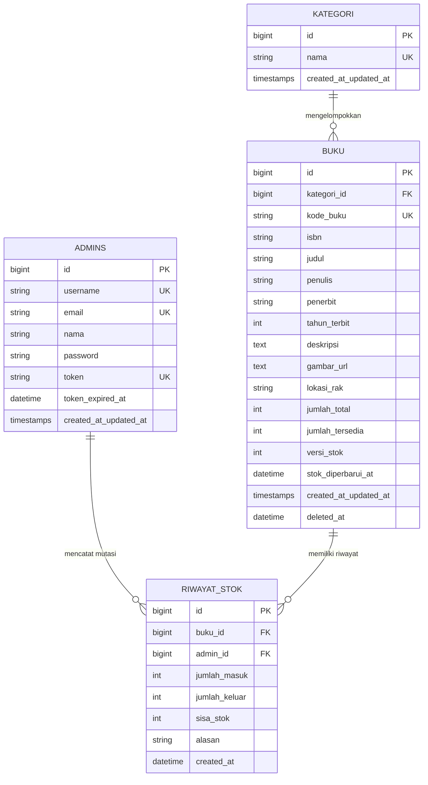

# Dokumentasi Resmi Sistem Web Service Perpustakaan

> **UTS Pemrograman Web Service · Kelompok 2**  
> *Sistem Informasi Ketersediaan Koleksi Buku, Audit Stok Fisik, dan RESTful API v1*

---

## 1. Status Sistem & Metrik Terkini (Otomatis Terupdate)

Bagian ini diperbarui secara otomatis setiap kali ada perubahan skrip atau saat *commit* Git dilakukan:

<!-- AUTO-GENERATED-METRICS-START -->
| Parameter Sistem | Nilai Status Aktual | Keterangan |
| :--- | :--- | :--- |
| **Terakhir Diperbarui** | **2026-11-09 21:00:48 WIB** | Diperbarui secara otomatis oleh sistem |
| **Cabang Git (Branch)** | `main` | Jalur utama repositori kelompok |
| **Hash Komit Terakhir** | `19fca7b` | `merge: selesaikan konflik dan gabungkan pembaruan tim` |
| **Total Endpoint REST API** | **15 Endpoint** | Versi v1 terstandarisasi OpenAPI 3.0.3 |
| **Total Rute Aplikasi** | **17 Rute** | 2 Web Portal + 15 REST API |
| **Pengujian PHPUnit** | **32 Skenario (182 Assertions)** | 31 Passed, 1 Skipped (Driver spesifik) |
| **Pengujian Newman/Postman** | **22 Skenario (60 Assertions)** | 100% Passed, 0 Failures |
| **Linting OpenAPI (Redocly)** | **0 Error, 0 Warning** | Kontrak API sinkron dan valid |
| **PHP & Framework** | PHP 8.4 / 8.5 · Laravel 12.x | Runtime produksi terverifikasi |
| **Basis Data Aktif** | MySQL / MariaDB | Tabel `buku`, `kategori`, `admins`, `riwayat_stok` |
<!-- AUTO-GENERATED-METRICS-END -->

### Integritas Berkas Skrip Kunci
<!-- AUTO-GENERATED-FILES-START -->
| Berkas Skrip Utama | Hash SHA-256 (8) | Waktu Modifikasi Terakhir | Status Integritas |
| :--- | :--- | :--- | :--- |
| `public/js/perpustakaan.js` | `9087943c` | 2026-11-09 13:38:42 | Aktif & Valid |
| `public/css/perpustakaan.css` | `3fe16fa6` | 2026-11-09 13:38:42 | Aktif & Valid |
| `resources/views/perpustakaan.blade.php` | `291a4df0` | 2026-11-09 09:47:37 | Aktif & Valid |
| `routes/api.php` | `3bf46e6b` | 2026-11-09 05:56:07 | Aktif & Valid |
| `routes/web.php` | `6d6cc07f` | 2026-11-09 05:56:07 | Aktif & Valid |
| `app/Http/Controllers/Api/V1/BukuController.php` | `c979c138` | 2026-11-09 05:56:06 | Aktif & Valid |
| `app/Http/Controllers/Api/V1/AuthController.php` | `faaf3d6d` | 2026-11-08 20:03:05 | Aktif & Valid |
| `app/Http/Controllers/Api/V1/KategoriController.php` | `203384a3` | 2026-11-08 20:03:05 | Aktif & Valid |
| `app/Services/BukuService.php` | `36ccc340` | 2026-11-09 05:56:07 | Aktif & Valid |
| `database/seeders/DokumenBukuSeeder.php` | `fdd9852d` | 2026-11-09 13:38:20 | Aktif & Valid |
| `database/seeders/data/buku-dokumen.json` | `375af0c3` | 2026-11-09 13:38:42 | Aktif & Valid |
<!-- AUTO-GENERATED-FILES-END -->

---

## 2. Identitas Tim Pengembang & Distribusi Peran

Aplikasi ini dikembangkan oleh **Kelompok 2** untuk memenuhi Ujian Tengah Semester (UTS) mata kuliah **Pemrograman Web Service**:

| Nama Lengkap | NIM | Peran Utama & Lingkup Pekerjaan |
| :--- | :--- | :--- |
| **Damiri** | 23215020 | **Pengujian Sistem & Validasi API:** Penulisan suite test PHPUnit, simulasi edge case validasi, pengujian batas kuota, dan verifikasi error code HTTP. |
| **Mochamad Bilal Muadzin** | 23215025 | **Arsitektur Backend, Database & Kontrak API:** Perancangan skema database, kontrol konkurensi (`versi_stok`), Service layer atomik, spesifikasi OpenAPI YAML, dan Word docx. |
| **Nofia Lindawati** | 23215034 | **Dokumentasi, Laporan UTS & Materi Presentasi:** Penyusunan laporan teknis, perancangan slide presentasi kelompok, dokumentasi arsitektur, dan ringkasan fitur. |
| **Viryal Arliyani** | 23215033 | **Fitur Search, Filter, Pagination & Controller API:** Implementasi query dinamis katalog buku, filter kategori multi-kondisi, pagination terstandarisasi, dan kontroler RESTful v1. |
| **Septina Asti Nabila** | 23215005 | **Uji Skenario Postman & Input Data Koleksi:** Pembuatan koleksi Newman/Postman, pengujian 22 skenario transaksional, penyusunan data awal 10 buku referensi dokumen, dan bukti pengujian. |

---

## 3. Arsitektur Sistem & Spesifikasi Teknologi

Aplikasi mengadopsi pola arsitektur berlapis (*Layered Architecture*) yang memisahkan tanggung jawab secara tegas (*Separation of Concerns*):

```
┌─────────────────────────────────────────────────────────────┐
│                      PRESENTATION LAYER                     │
│  - Katalog Siswa (/)             - Ruang Kerja Admin (/admin)│
│  - Vanilla JS ES2022+ Engine     - Modular CSS & Sticky Nav │
└──────────────────────────────┬──────────────────────────────┘
                               │ HTTP / JSON
┌──────────────────────────────▼──────────────────────────────┐
│                      RESTful API v1 LAYER                   │
│  - AuthController                - BukuController           │
│  - KategoriController            - MetadataController       │
│  - Form Request Validation       - Eloquent API Resources   │
└──────────────────────────────┬──────────────────────────────┘
                               │ Dependency Injection
┌──────────────────────────────▼──────────────────────────────┐
│                    SERVICE & DOMAIN LAYER                   │
│  - BukuService (Transaksi Stok, Optimistic Locking, Audit)  │
│  - GoogleBooksAdapter & OpenLibrary Fallback Provider       │
└──────────────────────────────┬──────────────────────────────┘
                               │ Eloquent ORM
┌──────────────────────────────▼──────────────────────────────┐
│                      DATA PERSISTENCE                       │
│  - MySQL / MariaDB (Driver Produksi & Testing Lokal)        │
│  - SQLite :memory: (Suite Uji Cepat PHPUnit)                │
└─────────────────────────────────────────────────────────────┘
```

### Karakteristik Teknis Unggulan:
1. **Optimistic Concurrency Control:**
   * Setiap mutasi stok pada tabel `buku` dilindungi oleh kolom integer `versi_stok`.
   * Jika dua admin memperbarui buku yang sama secara bersamaan, sistem mendeteksi konflik versi dan membatalkan mutasi dengan respons **HTTP 409 Conflict**.
2. **Transaksi Atomik (ACID):**
   * Perubahan stok (`jumlah_total` dan `jumlah_tersedia`) dijalankan dalam blok `DB::transaction()` bersama pencatatan riwayat audit pada tabel `riwayat_stok`.
   * Jika salah satu operasi gagal, seluruh transaksi di-*rollback* secara otomatis.
3. **Penyedia Metadata Fleksibel:**
   * Terintegrasi dengan **Google Books API v1** untuk mencari metadata buku secara langsung.
   * Dilengkapi cache otomatis berbasis SHA-256 dan fallback gracefully tanpa memblokir fungsi utama jika koneksi internet terputus.

---

## 4. Struktur Basis Data & Hubungan Antar-Tabel

Basis data `perpustakaan` dirancang dengan integritas relasional tinggi:



* **Penghapusan Aman (*Soft Deletes*):** Tabel `buku` menggunakan `deleted_at`. Menghapus buku dari katalog tidak menghapus riwayat fisik atau log mutasi yang pernah terjadi di perpustakaan.

---

## 5. Spesifikasi Lengkap RESTful API v1 (15 Endpoints)

Seluruh endpoint API berada di bawah prefix `/api/v1/` dengan header wajib `Accept: application/json`.

### A. Autentikasi Admin
| Method | URL Endpoint | Auth | Deskripsi | Status Sukses |
| :--- | :--- | :--- | :--- | :--- |
| `POST` | `/api/v1/auth/login` | Publik | Masuk akun admin & menerima Bearer token (aktif 8 jam) | `200 OK` |
| `POST` | `/api/v1/auth/logout` | Bearer | Cabut token admin aktif | `200 OK` |

### B. Manajemen Master Kategori
| Method | URL Endpoint | Auth | Deskripsi | Status Sukses |
| :--- | :--- | :--- | :--- | :--- |
| `GET` | `/api/v1/kategori` | Publik | Ambil daftar seluruh kategori buku | `200 OK` |
| `POST` | `/api/v1/kategori` | Bearer | Tambah kategori baru | `201 Created` |
| `GET` | `/api/v1/kategori/{id}` | Publik | Ambil detail satu kategori | `200 OK` |
| `PUT` | `/api/v1/kategori/{id}` | Bearer | Perbarui nama kategori | `200 OK` |
| `DELETE` | `/api/v1/kategori/{id}` | Bearer | Hapus kategori (hanya jika tidak dipakai buku) | `204 No Content` |

### C. Manajemen Koleksi Buku
| Method | URL Endpoint | Auth | Deskripsi | Status Sukses |
| :--- | :--- | :--- | :--- | :--- |
| `GET` | `/api/v1/buku` | Publik | Pencarian, filter kategori, status ketersediaan, pagination | `200 OK` |
| `POST` | `/api/v1/buku` | Bearer | Tambah buku baru ke koleksi | `201 Created` |
| `GET` | `/api/v1/buku/{id}` | Publik | Detail lengkap buku beserta info stok & rak | `200 OK` |
| `PUT` | `/api/v1/buku/{id}` | Bearer | Perbarui data metadata buku | `200 OK` |
| `DELETE` | `/api/v1/buku/{id}` | Bearer | Arsipkan buku dari katalog (*Soft Delete*) | `204 No Content` |

### D. Kontrol Mutasi Stok & Riwayat Audit
| Method | URL Endpoint | Auth | Deskripsi | Status Sukses |
| :--- | :--- | :--- | :--- | :--- |
| `PATCH` | `/api/v1/buku/{id}/stok` | Bearer | Mutasi stok atomik dengan verifikasi `versi_stok` | `200 OK` |
| `GET` | `/api/v1/buku/{id}/riwayat-stok` | Bearer | Ambil catatan audit riwayat perubahan stok buku | `200 OK` |

### E. Integrasi Metadata Eksternal
| Method | URL Endpoint | Auth | Deskripsi | Status Sukses |
| :--- | :--- | :--- | :--- | :--- |
| `GET` | `/api/v1/metadata?q={judul}` | Publik | Cari metadata referensi dari Google Books API | `200 OK` |

---

## 6. Antarmuka Pengguna & Fitur Frontend

Antarmuka web dibangun tanpa framework JavaScript eksternal yang berat, menggunakan **Vanilla JS ES2022+** dan **CSS responsif**:

1. **Header Beku (*Sticky Navigation*):**
   * Bilah navigasi tetap berada di atas layar dengan efek kaca buram (*backdrop blur*) saat halaman digulir, memudahkan navigasi cepat siswa dan admin.
2. **Panggung Pilihan 3D (*Featured Stage*):**
   * Menampilkan buku pilihan (seperti novel *"Bumi"*) dengan kemiringan rotasi 3D dan bayangan kedalaman elegan.
   * Sampul buku diatur dengan rasio aspek standar potret tanpa distorsi gambar (`object-fit: cover; object-position: center;`).
3. **Sistem Sampul Dinamis (*Dynamic Book Covers*):**
   * Jika buku memiliki URL sampul (`gambar_url`), gambar ditampilkan menggunakan atribut `referrerpolicy="no-referrer"` agar tidak diblokir oleh server eksternal seperti Google Books.
   * Jika tidak ada gambar atau gambar gagal dimuat, sistem secara otomatis merender sampul tipografi bergaya penerbit klasik dengan salah satu dari 6 palet warna berbasis kode buku.
4. **Modal Dialog Interaktif:**
   * Detail buku, pencarian metadata Google Books, form penambahan koleksi, mutasi stok atomik, dan riwayat audit disajikan dalam dialog `<dialog>` ramah aksesibilitas.

---

## 7. Mekanisme Otomatis Terupdate Setiap Perubahan Skrip

Dokumentasi ini dilengkapi dengan infrastruktur otomatisasi terpadu sehingga selalu sinkron dengan kondisi kode:

### A. Otomatisasi Git Hook (`pre-commit`)
File hook telah aktif pada `.git/hooks/pre-commit`:
```sh
#!/bin/sh
# Terpanggil otomatis setiap kali 'git commit' dijalankan
if [ -f "scripts/update-docs.php" ]; then
    echo "Memperbarui DOKUMENTASI.md otomatis sebelum commit..."
    php scripts/update-docs.php
    git add DOKUMENTASI.md
fi
exit 0
```
*Setiap kali anggota tim melakukan `git commit`, skrip akan otomatis menghitung ulang metrik, mencatat commit hash terbaru, memeriksa integritas file, dan memasukkannya ke dalam commit tersebut.*

### B. File Watcher Realtime (`scripts/watch-docs.ps1`)
Untuk pemantauan berkala saat sedang *coding*, jalankan watcher:
```powershell
powershell -ExecutionPolicy Bypass -File .\scripts\watch-docs.ps1
```
*Watcher memantau folder `app/`, `routes/`, `public/`, `database/`, dan `resources/`. Saat ada file skrip yang disimpan, `DOKUMENTASI.md` langsung diperbarui dalam hitungan milidetik.*

### C. Perintah CLI Manual / Composer
Anda juga dapat memperbarui dokumentasi kapan saja melalui:
```powershell
# Melalui Composer
composer run docs:update

# Atau melalui Node/NPM
npm run docs:update

# Atau langsung via PHP
php scripts/update-docs.php
```

---

## 8. Panduan Menjalankan & Verifikasi Pengujian

### Menjalankan Server Lokal:
```powershell
powershell -ExecutionPolicy Bypass -File .\scripts\mulai.ps1
```
* **Katalog Siswa:** `http://127.0.0.1:8000`
* **Ruang Kerja Admin:** `http://127.0.0.1:8000/admin`
* **Kredensial Admin Demo:** Email `adminperpustakaan@gmail.com` / Username `Admin` (Kata sandi dari `.env`: `DEMO_PASSWORD`).

### Menjalankan Suite Pengujian:
```powershell
# 1. PHPUnit Automated Tests
php artisan test --compact

# 2. Linting Kontrak OpenAPI 3.0.3
npm run lint:api

# 3. Verifikasi Sintaks JavaScript
node --check public/js/perpustakaan.js
```

---
*Dokumentasi ini dikelola secara otomatis oleh sistem otomasi repositori Kelompok 2.*
