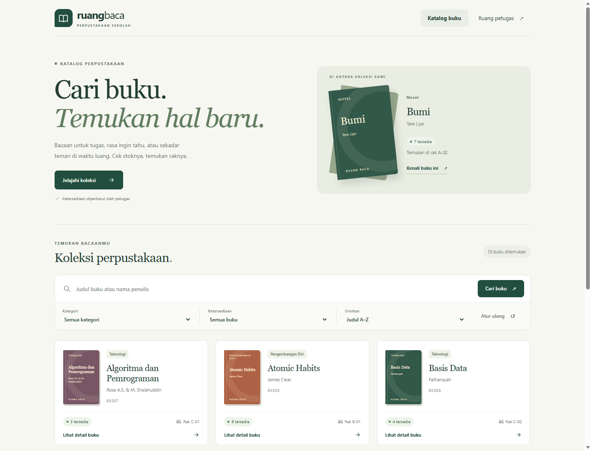

# Web Service Ketersediaan Buku Perpustakaan

**UTS Pemrograman Web Service · Kelompok 2**

Laravel · MySQL/MariaDB · REST API v1

Membantu siswa menemukan buku, memeriksa stok, dan mengetahui lokasi rak sebelum datang ke perpustakaan. Petugas mengelola koleksi melalui satu sumber data.



## Demo online untuk presentasi

**[Buka Demo Website](https://match-simpsons-referred-mother.trycloudflare.com)**

[Katalog siswa](https://match-simpsons-referred-mother.trycloudflare.com) · [Login petugas](https://match-simpsons-referred-mother.trycloudflare.com/petugas) · [API buku](https://match-simpsons-referred-mother.trycloudflare.com/api/v1/buku)

Anggota kelompok dapat membuka link di atas dari browser tanpa memasang aplikasi. Link bersifat publik; fitur petugas tetap memerlukan login. Kata sandi dibagikan secara pribadi, bukan di GitHub.

Link sementara ini hanya aktif selama komputer penyaji, server Laravel, koneksi internet, dan Cloudflare Tunnel tetap berjalan. Jika tunnel dijalankan ulang, alamat dapat berubah; perbarui link di bagian ini sebelum presentasi berikutnya.

## Fitur utama

- **Siswa:** pencarian judul/penulis, filter kategori, detail buku, stok dan lokasi rak.
- **Petugas:** login, kelola buku/kategori, pembaruan stok dan riwayat perubahan.
- **API:** 15 endpoint berversi, pagination, validasi dan respons JSON seragam.
- **Konsistensi:** transaksi, penguncian stok, deteksi konflik dan rollback.
- **Metadata:** Open Library dengan timeout, retry, cache dan fallback.

Fokus pada ketersediaan buku. Peminjaman, pengembalian, denda dan reservasi berada di luar lingkup.

## Anggota Kelompok 2

| Nama | NIM |
| --- | --- |
| Damiri | 23215020 |
| Mochamad Bilal Muadzin | 23215025 |
| Nofia Lindawati | 23215034 |
| Viryal Arliyani | 23215033 |
| Septina Asti Nabila | 23215005 |

Program: **Bilal**, Laporan dan PPT: **Nofia**. [Rencana kontribusi](docs/kontribusi.md).

## Jalankan aplikasi

Pada komputer Bilal, buka folder `UTS Perpustakaan Kelompok 2/perpustakaan`, lalu jalankan:

```powershell
powershell -ExecutionPolicy Bypass -File .\scripts\mulai.ps1
```

[Portal siswa](http://127.0.0.1:8000) · [Login petugas](http://127.0.0.1:8000/petugas) · [API buku](http://127.0.0.1:8000/api/v1/buku)

Email petugas: `petugas@perpustakaan.test`. Gunakan kata sandi akun terbaru; kredensial tidak dicantumkan di repository.

<details>
<summary><strong>Instalasi di komputer lain</strong></summary>

Siapkan PHP 8.5, Composer, MySQL/MariaDB dan Node.js 24 untuk lint API.

```powershell
composer install --no-interaction
if (!(Test-Path .env)) {
    Copy-Item .env.example .env
    php artisan key:generate
}
```

Buat database `perpustakaan` dan `perpustakaan_test`. Atur `DB_HOST`, `DB_PORT`, `DB_DATABASE`, `DB_USERNAME`, `DB_PASSWORD`, serta `DEMO_PASSWORD` minimal 12 karakter pada `.env`. Gunakan file `.env` yang sudah ada jika aplikasi pernah dipasang.

```powershell
php artisan migrate --seed
php artisan serve
```

Seeder menyediakan 10 contoh buku. Kata sandi awal berasal dari `DEMO_PASSWORD`; seeder tidak mengganti kata sandi akun yang sudah ada. [Panduan lengkap](docs/panduan-teknis.md#instalasi-di-komputer-lain).

</details>

## Uji dan demo

```powershell
php artisan test --compact
php vendor/bin/phpunit --configuration phpunit.mysql.xml
npm ci --ignore-scripts
npm run lint:api
```

Suite MySQL memakai database `perpustakaan_test`. [Hasil pengujian aktual](docs/hasil-pengujian.md).

**Alur demo:** cari/filter buku → tambah buku **201 + Location** → validasi **422** → data tidak ditemukan **404** → konflik stok **409** → audit/rollback → metadata normal dan fallback.

## Dokumentasi

[OpenAPI](docs/openapi.yaml) · [Postman](docs/postman/collection.json) · [Panduan teknis](docs/panduan-teknis.md) · [Bahan laporan](docs/bahan-laporan.md) · [Checklist release v1.1.0](docs/release.md)
