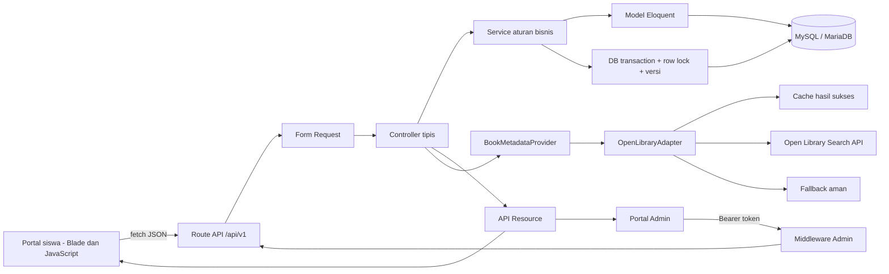
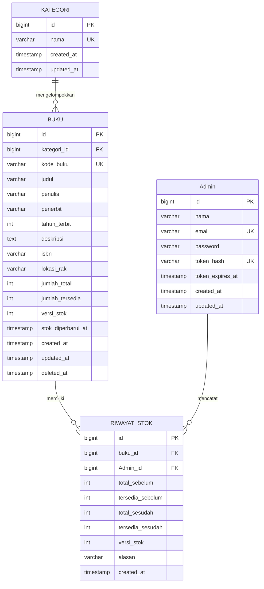
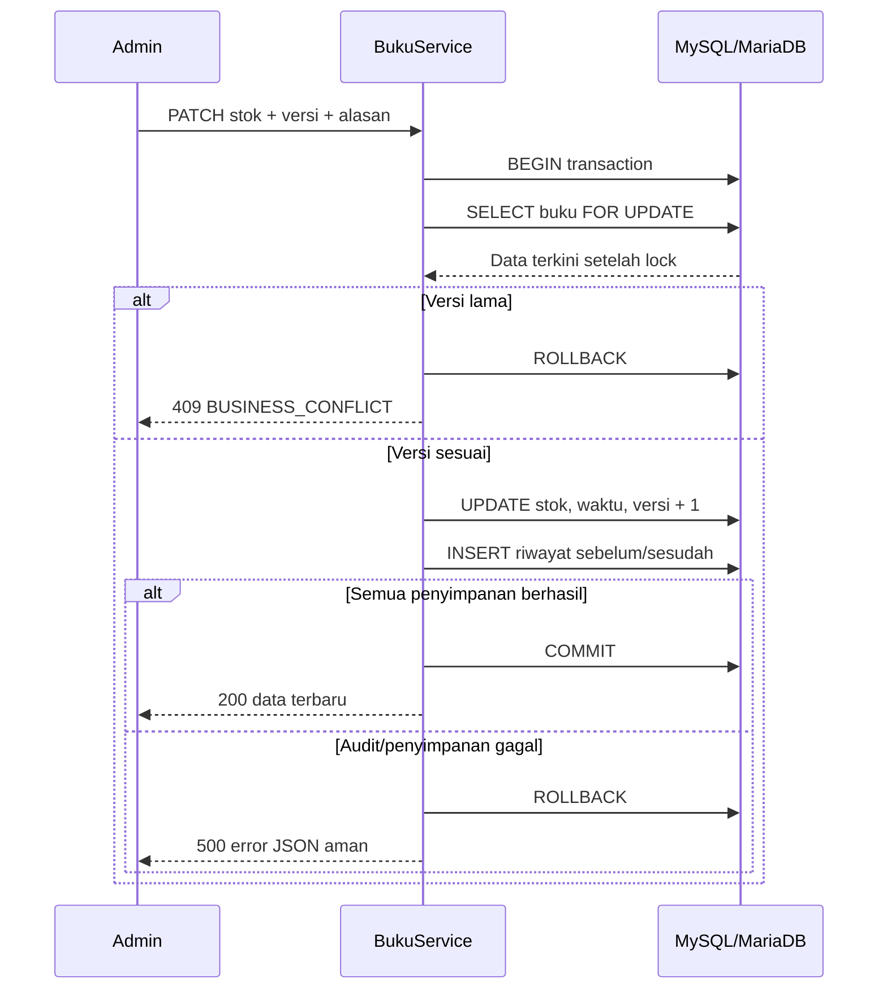

# Bahan Laporan dan PPT UTS — Kelompok 2

**Judul resmi:** Web Service Ketersediaan Buku Perpustakaan. **Versi kandidat:** v1.1.0. **Tanggal pemeriksaan lokal:** 8 November 2026 (WIB).

Mochamad Bilal Muadzin, NIM 23215025, mengerjakan program dengan bantuan AI. Nofia Lindawati, NIM 23215034, menyusun laporan dan PPT dari program, hasil pengujian dan pengamatan sendiri. Salinan Word/PPT sudah disusun di folder induk `Hasil UTS Kelompok 2` dan masih perlu ditinjau kelompok.

## 1. Latar belakang, tujuan dan batasan

Siswa membutuhkan cara mengetahui apakah buku tersedia dan di rak mana buku disimpan, tanpa harus mengecek satu per satu. Admin membutuhkan data koleksi dan ketersediaan yang konsisten.

Aplikasi menyediakan pencarian judul/penulis, kategori, penerbit, tahun terbit, lokasi rak, jumlah total/tersedia dan waktu pembaruan. Admin dapat masuk, mengelola kategori/buku dan mencatat perubahan stok. Peminjaman, pengembalian, denda dan reservasi tidak dibuat karena berada di luar lingkup informasi ketersediaan.

Koleksi awal sekarang berisi 10 buku dari dokumen kelompok, lima kategori dokumen dan satu akun Admin. Judul, penulis, penerbit, tahun, kategori dan jumlah mengikuti dokumen; lokasi rak adalah contoh tambahan. Lihat `acuan-dokumen.md` untuk tabel sumber dan pemetaan nama field. Pada database yang diperbarui, kategori lama tetap disimpan untuk relasi buku arsip.

## 2. Arsitektur program

Route API berversi memudahkan perubahan kontrak di masa depan. Form Request memvalidasi data sebelum controller. Controller meneruskan permintaan ke service. Service menyimpan aturan bisnis, transaksi dan konsistensi. Model menangani relasi database; API Resource menentukan field yang dikirim ke klien. Semua error API dirender dalam bentuk JSON yang seragam pada `bootstrap/app.php`.

Tampilan tidak mengakses database langsung. Halaman siswa memakai API publik melalui `fetch`; halaman Admin memakai API yang sama dengan token untuk operasi pengelolaan. Tidak ada koleksi buku statis di JavaScript.

## 3. ERD dan relasi

Nama tabel fisik: `kategori`, `buku`, `Admin`, `riwayat_stok`. Satu kategori memiliki banyak buku. Setiap catatan perubahan stok terkait satu buku dan satu Admin. Foreign key menggunakan pembatasan penghapusan. Pasangan `buku_id, versi_stok` pada riwayat unik. Kode buku dan nama kategori unik. MySQL/MariaDB juga mempunyai CHECK stok tersedia tidak negatif dan tidak melebihi total.

Buku menggunakan soft delete agar audit tetap dapat ditelusuri. Kode buku arsip tetap dicadangkan dan kategori yang dipakai buku arsip tetap dilindungi. Laravel masih memiliki tabel infrastruktur bawaan `users`, `password_reset_tokens`, `sessions`, cache dan jobs dari skeleton. Login aplikasi ini menggunakan `Admin`, bukan tabel `users`. Tabel infrastruktur bukan modul peminjaman.

Model dan factory tersedia untuk keempat entitas. Seeder memberi koleksi awal dan riwayat stok awal dalam transaksi. Seeder yang diulang tidak menggandakan data atau menimpa buku yang telah diedit.

## 4. Endpoint dan kontrak

Base URL lokal `http://127.0.0.1:8000/api/v1`. Terdapat **15 pasangan metode/path**, lebih dari minimum 8 endpoint. Perincian field, schema, contoh dan status code terdapat pada `openapi.yaml`.

| Metode | Endpoint | Fungsi | Akses |
| --- | --- | --- | --- |
| POST | `/auth/login` | Login, token berlaku 8 jam | Publik |
| POST | `/auth/logout` | Cabut token aktif | Admin |
| GET | `/buku` | Daftar, cari, filter, urutan, pagination | Publik |
| GET | `/buku/{buku}` | Detail dan ketersediaan | Publik |
| POST | `/buku` | Buku dan audit awal, 201 + Location | Admin |
| PUT | `/buku/{buku}` | Edit data deskriptif | Admin |
| DELETE | `/buku/{buku}` | Arsipkan buku, 204 | Admin |
| PATCH | `/buku/{buku}/stok` | Perbarui jumlah dan audit | Admin |
| GET | `/buku/{buku}/riwayat-stok` | Audit terbaru, 20 per halaman | Admin |
| GET | `/kategori` | Daftar kategori | Publik |
| GET | `/kategori/{kategori}` | Detail kategori | Publik |
| POST | `/kategori` | Tambah, 201 + Location | Admin |
| PUT | `/kategori/{kategori}` | Edit kategori | Admin |
| DELETE | `/kategori/{kategori}` | Hapus kategori kosong | Admin |
| GET | `/metadata?q=...` | Metadata dari Open Library | Publik |

Parameter daftar buku: `q`, `kategori_id`, `tersedia`, `sort`, `direction`, `per_page`, `page`. Pencarian memeriksa judul atau penulis. Pengurutan dibatasi pada kolom yang diizinkan; nama kolom tidak diterima bebas dari pengguna. Respons berhalaman memiliki `data`, `links`, `meta`. Portal menggunakan data ini untuk tombol halaman.

Versi `/v1` adalah versi mayor route. `info.version: 1.1.0` adalah versi kontrak dan kandidat rilis. Perbedaan keduanya perlu dijelaskan pada presentasi.

## 5. Aturan bisnis dan konsistensi transaksi

1. `0 ≤ jumlah_tersedia ≤ jumlah_total`; total maksimal 1.000.000; semua jumlah bilangan bulat.
2. Kode buku unik, kategori harus ada, dan field wajib harus terisi.
3. Mengubah stok wajib mengirim versi yang dibaca dari detail serta alasan perubahan.
4. `PUT /buku/{id}` tidak dapat mengubah jumlah atau versi stok; perubahan jumlah melalui endpoint stok.
5. Kategori yang dipakai buku aktif/arsip tidak boleh dihapus. Buku diarsipkan, bukan dihapus permanen.
6. Password di-hash, token hanya dikirim saat login dan disimpan sebagai hash SHA-256 pada database. Login baru mengganti token lama; logout mencabut token. Satu token aktif per Admin.

Urutan pembaruan stok:

Penguncian baris menahan penulis kedua sampai transaksi pertama selesai. Versi kemudian diperiksa ulang; penulis dengan versi lama mendapat 409. DB::transaction mencoba ulang deadlock sampai tiga kali. Riwayat dan stok tidak dapat berhasil sebagian. Uji dua proses memakai dua koneksi pada database tes MariaDB, bukan hanya dua request berurutan.

**422** berarti data input tidak valid, misalnya tersedia 11 dari total 10. **409** berarti input dapat valid secara bentuk, tetapi bertentangan dengan keadaan bisnis saat ini, misalnya versi stok lama atau kategori masih dipakai. **404** berarti data/endpoint tidak ditemukan. **201** menunjukkan penciptaan data berhasil dan mempunyai Location. **401** akses Admin belum sah. **204** operasi berhasil tanpa body.

## 6. Integrasi layanan luar

Penyedia: [Open Library Search API](https://openlibrary.org/dev/docs/api/search), dipilih berdasarkan dokumentasi resmi. Adapter mengikuti `BookMetadataProvider` sehingga penyedia dapat diganti tanpa mengubah controller.

Permintaan ke `/search.json` memakai parameter `q`, `limit=5`, dan field `key,title,author_name,first_publish_year,isbn`. Hasil dinormalisasi menjadi judul, penulis, tahun, ISBN. Metadata luar bukan sumber kebenaran stok lokal dan tidak otomatis menambah buku.

Timeout per usaha default 4 detik, connect timeout 2 detik, maksimal 2 usaha dengan jeda 200 ms. Hasil sukses dicache 3600 detik. Kegagalan tidak dicache. Jika layanan gagal, adapter menghasilkan `source=local`, `fallback=true`, dan `items=[]`; klien tetap menggunakan pencarian buku lokal. Pengaturan berada di `config/services.php` dan variabel lingkungan, bukan ditanam pada controller.

Pada pemeriksaan awal jaringan nyata, integrasi menghasilkan fallback karena PHP belum memiliki CA bundle (cURL error 60). Sesudah bundle resmi curl/Mozilla diunduh dan hash SHA-256 diverifikasi, permintaan melalui API proyek berhasil dengan `source=openlibrary`, `fallback=false`, lima item Laskar Pelangi dan karya terkait. Verifikasi sertifikat tetap aktif. Berkas CA lokal tidak masuk repository; panduan konfigurasi ada di README.

Normal, 503/retry, timeout, format tidak sesuai, cache, dan kegagalan yang tidak dicache juga diuji memakai `Http::fake`. Simulasi disebut simulasi dalam laporan; jangan menyatakannya sebagai gangguan penyedia yang benar-benar terjadi.

## 7. Hasil pengujian aktual

Lihat `hasil-pengujian.md` untuk rincian dan batas pemeriksaan. Hasil akhir yang sudah diamati:

- Suite default SQLite: 30 kasus, 29 lulus dan 1 uji khusus MySQL dilewati, 164 assertions.
- Suite feature MariaDB: 29 tes lulus, termasuk dua proses bersamaan, 169 assertions; tidak ada yang dilewati.
- Collection Postman dijalankan dengan Newman: 22 request, 60 assertions, 0 gagal.
- Kontrak OpenAPI berhasil di-lint tanpa error/peringatan. Tes membandingkan 15 method/path dan versi kontrak dengan implementasi.
- Pemeriksaan Edge tanpa jendela terlihat: 14 alur berhasil, 0 error JavaScript. Termasuk viewport ponsel 390 px tanpa overflow horizontal, pencarian, detail, login, CRUD buku/kategori, stok, riwayat dan logout.
- Pemeriksaan koneksi eksternal nyata berhasil setelah CA diperbaiki; fallback nyata juga sempat diamati sebelum perbaikan.
- Audit dependency npm akhir: 0 kerentanan pada paket yang dipertahankan. Newman digunakan sementara untuk verifikasi collection lalu dilepas karena dependency turunannya terdeteksi rentan.

Ringkasan aktual dicatat pada `hasil-pengujian.md`; hasil browser dan output Newman mentah berada di `.local` yang diabaikan Git. Output Newman mentah dapat berisi token/kredensial; gunakan ringkasan yang sudah ditulis, bukan membagikan file tersebut. Jika mengekspor hasil tes XML, pola `storage/tests-*.xml` juga sudah diabaikan Git.

## 8. Mengambil screenshot untuk laporan

Gambar pemeriksaan browser sudah tersedia di `docs/screenshots/`. Gambar itu hasil render aplikasi sebenarnya, bukan desain ilustrasi. Jumlah buku pada gambar selama pengujian dapat mencakup buku demo UI; setelah pemeriksaan, buku demo diarsipkan dan 10 buku dokumen tetap aktif. Gambar berikut bisa dipakai sebagai bahan awal:

- `katalog-desktop.png`: katalog desktop.
- `katalog-ponsel.png`: tampilan ponsel.
- `detail-buku.png`: detail, rak, kategori, stok dan waktu.
- `Admin-desktop.png`: pengelolaan koleksi sesudah login.
- `riwayat-stok.png`: jejak sebelum/sesudah stok.

Nofia sebaiknya mencoba dan memilih screenshot sendiri untuk mengonfirmasi hasil:

1. Jalankan aplikasi sesuai README. Buka katalog, tampilkan daftar, hasil pencarian, filter dan halaman kedua. Gunakan `Win+Shift+S`, simpan PNG dan beri keterangan fungsi.
2. Buka detail satu buku; ambil gambar kategori, lokasi rak, jumlah dan waktu pembaruan.
3. Di browser tekan F12, buka tab Network, lalu muat ulang katalog. Pilih request `/api/v1/buku`; ambil gambar response JSON untuk membuktikan portal membaca API.
4. Login Admin. Jangan menampilkan password, isi `.env`, token, atau header Authorization pada gambar. Ambil tabel buku, formulir stok dan riwayat setelah memperbarui satu buku demo.
5. Di Postman ambil gambar 201 beserta Location, daftar/filter/pagination 200, 422, 404 dan 409. Tutup bagian token dan environment rahasia.
6. Untuk transaksi, ambil hasil tes rollback dan hasil dua proses pada suite MySQL. Jelaskan bahwa rollback dibuat dengan kegagalan audit di tes, bukan lewat tombol pengguna.
7. Ambil hasil metadata normal dari API dan hasil simulasi gagal dari tes. Beri label yang membedakan hasil nyata dan simulasi.
8. Ambil hasil lint dan hasil tes yang benar-benar muncul pada terminal. Jangan mengedit angka kelulusan pada gambar.

## 9. Rancangan PPT

1. Judul, identitas dan pembagian tugas.
2. Masalah, tujuan dan batas aplikasi.
3. Arsitektur web service dan portal siswa melalui API.
4. ERD empat tabel utama.
5. Contoh endpoint dan kontrak OpenAPI.
6. Perbedaan validasi 422 dan konflik 409.
7. Diagram transaksi, row lock, versi stok dan rollback.
8. Integrasi Open Library: adapter, timeout, retry, cache, fallback.
9. Demo tampilan dan hasil pengujian aktual.
10. Kontribusi GitHub nyata dan pengembangan berikutnya.

## 10. Bagian yang masih perlu dilengkapi anggota

- NIM/nama lengkap Nofia, identitas kampus, dosen, kelas, dan format laporan resmi.
- Laporan akhir, PPT akhir, screenshot pilihan dan pembahasan dengan bahasa anggota sendiri.
- Repository GitHub kelompok sudah berisi kode awal. Undangan collaborator anggota/dosen serta minimum dua PR digabung dan satu review per anggota masih perlu dilengkapi, dengan URL bukti yang asli.
- GitHub Actions sudah dipicu oleh unggahan awal. Baca hasil sebenarnya pada tab Actions repository; hasil tes lokal tidak menggantikan hasil CI.
- Tag dan publikasi release v1.1.0 setelah review serta ketentuan kontribusi terpenuhi.
- Penyesuaian data buku bila akan dipakai pada perpustakaan sebenarnya. Tidak diperlukan untuk demo data contoh dokumen kelompok untuk UTS.

Usulan pembagian kontribusi nyata ada pada `kontribusi.md`. Repository kelompok sudah dibuat di https://github.com/bilaalmuhammad1030/uts-web-service-perpustakaan-kelompok-2 dan remote lokal sudah terhubung. Status terkini ada di `release.md`. Unggahan awal tidak dihitung sebagai PR atau review; dokumen ini tidak boleh dipakai untuk mengklaim kontribusi GitHub yang belum dilakukan.

## Penyesuaian dokumen kelompok

Penerbit dan tahun terbit telah ditambahkan pada model, migration, API, Form Request, factory, formulir dan detail siswa. Validasi panjang mengikuti dokumen; tahun wajib 1901 sampai tahun berjalan. Seeder memakai BK001–BK010. Persediaan dan audit tetap memakai transaksi, penguncian baris dan versi. Hapus tetap memerlukan konfirmasi dan menggunakan arsip agar riwayat tidak hilang. Nama `stok`/`tersedia` dalam dokumen dipetakan ke `jumlah_total`/`jumlah_tersedia`. Cadangan data lama dibuat dan data yang sudah diedit dilindungi. Lihat `acuan-dokumen.md` untuk keputusan lengkap.

